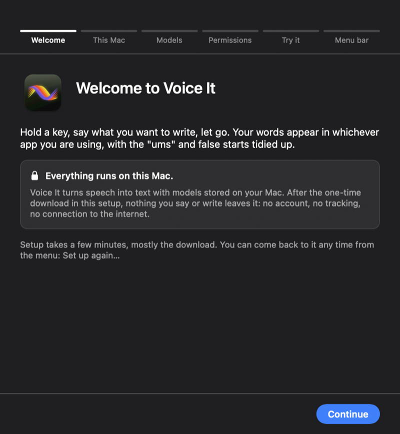
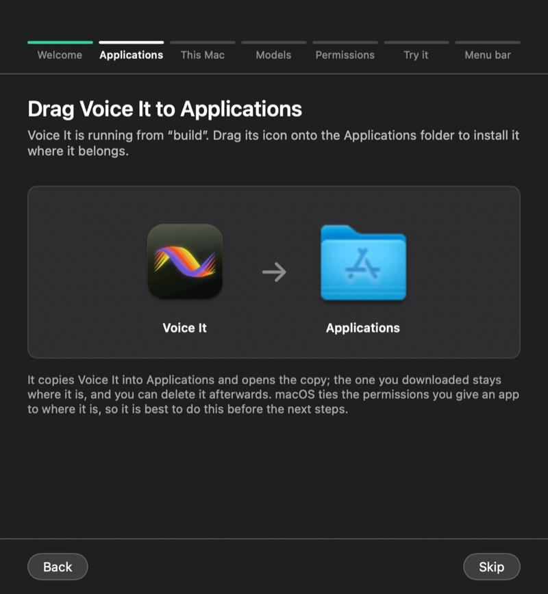
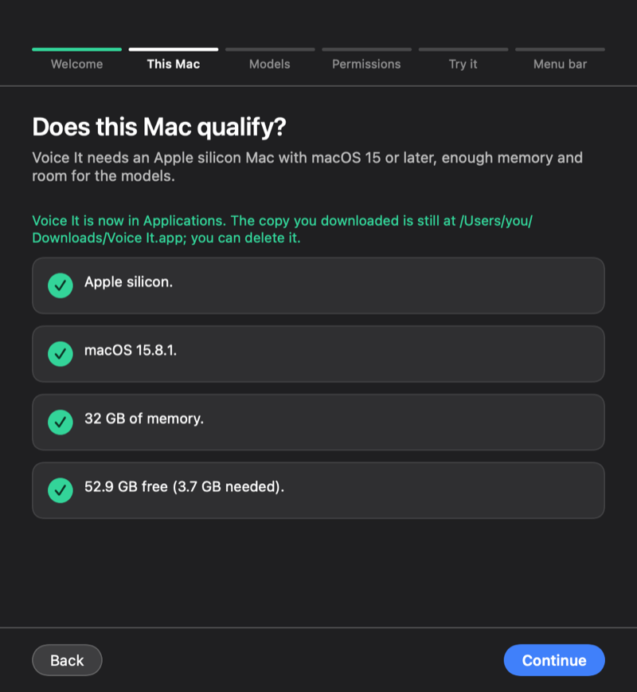
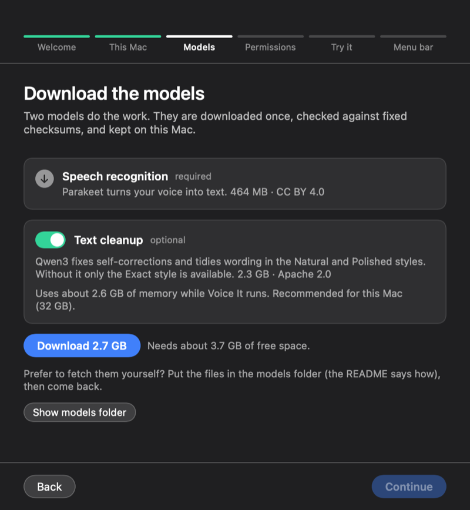
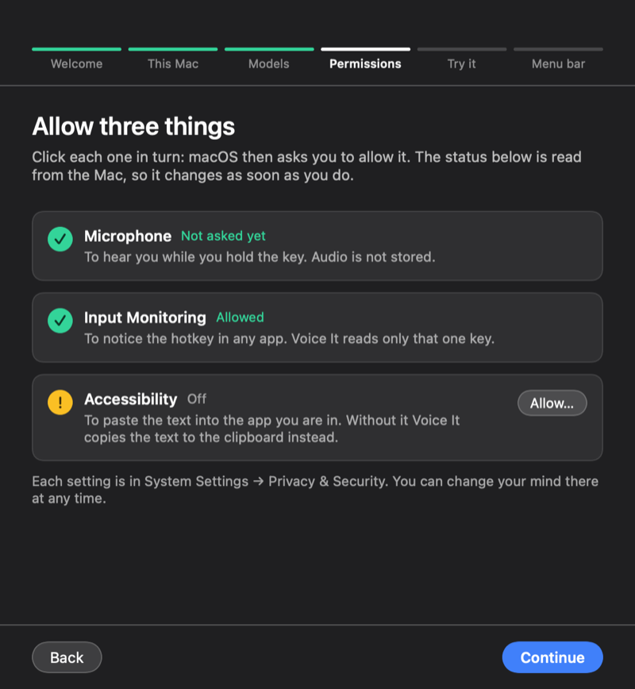

# Voice It

Private, on-device dictation for Mac.


https://github.com/user-attachments/assets/7e976aa7-0111-48c3-a34c-834886f5a2db

*A 40-second teaser. It is drawn, not recorded, so the real overlay looks a little different: see the setup pictures below.*

Hold a key, say what you want to write, let go. Voice It turns your speech into clean text and pastes it into whatever app you're using. The speech recognition and the tidy-up both run on your Mac, so your voice isn't sent anywhere.

It's a small, free, open-source side project, and it's in **beta**. It works well for me and I hope it's useful to you too.

[Download and install](#download-and-install) · [Privacy](PRIVACY.md) · [Check your download](#check-your-download) · [Updating](#updating) · [Uninstall](#uninstall) · [Using Voice It](#use) · [Build it yourself](#build-it-yourself) · [Licence](#licence)

## Why it might be useful

- **Private by design.** Once the models are downloaded, dictation works with no network connection. Nothing you say leaves your Mac. See [PRIVACY.md](PRIVACY.md) for exactly what the app does and doesn't do.
- **Works in most apps.** Hold the hotkey in Mail, Messages, Notes, a browser or an editor, and the text lands where your cursor is.
- **Tidies up as you speak.** Filler words and false starts can be cleaned up, or you can switch the language-model cleanup off (the Exact style) and keep your own words, with only "um" and "uh" taken out.
- **Free and open source.** GPL-3.0, no account, no subscription, no tracking.

## How it works

1. Hold **Right Option** and speak. (You can choose another key in the settings.)
2. A small glass pill shows that it's listening.
3. Let go. A moment later the text is pasted where you were typing.

**Hands-free:** hold the key, add **Shift**, and let go of both: it keeps listening until you click the check mark (or press the key again). **Copy only:** hold **Right Command** as well and the text goes to the clipboard instead of being pasted.


## Writing styles

Pick how much the app tidies your words (menu bar icon → Style):

- **Exact**: your words, with "um" and "uh" removed and spoken punctuation formatted ("new line", "question mark"). It uses no language model, so it needs the least memory and adds no delay.
- **Natural** (default): cleans up only when it helps, such as a correction ("Thursday… no, Friday") or a long ramble.
- **Polished**: always tidies the text, in a more formal tone.
- **Automatic by app** (beta): picks a style per app. It needs a small manual setting in the settings file.

## What's under the hood

- Speech recognition: [NVIDIA Parakeet TDT 0.6B v2](https://huggingface.co/nvidia/parakeet-tdt-0.6b-v2) (English), run through [FluidAudio](https://github.com/FluidInference/FluidAudio) on the Apple Neural Engine.
- Text cleanup: a small Qwen3 language model, run with [MLX](https://github.com/ml-explore/mlx-swift-lm).
- A native Swift and SwiftUI menu bar app. No Electron, no web view.

## Numbers, with caveats

On the Apple silicon Mac I test on, speech recognition takes roughly a tenth of a second, and cleanup adds a few hundred milliseconds when it's used. Memory use is about 35 MB with cleanup off, and around 2.5 GB while the cleanup model is loaded; Voice It can free that memory when it's idle (a setting). Your Mac and your results may differ.

The first launch downloads about 2.7 GB of models (about 0.5 GB without the cleanup model) and takes a few minutes. Preparing the speech model for your Mac takes about half a minute, once.

## Scope

- **A beta.** Expect rough edges. Please open an issue if something breaks.
- **English only.**
- **Apple silicon only**, macOS 15 or later.
- **Not signed or notarised.** I don't have a paid Apple Developer account, so macOS will ask you to approve the app on first launch. The install steps below walk through it, and permissions may need re-approving after an update.
- **Not for regulated or confidential material** such as patient or client records. It's a hobby project and hasn't been through any formal review.

## Download and install

**You need:** a Mac with Apple silicon (M1 or later), macOS 15 (Sequoia) or later, at least 8 GB of memory, and an internet connection for the first-run download only. The text cleanup model is tested and recommended on Macs with 16 GB or more; with less, Voice It still works with the Exact style (see below). About 3.7 GB of free disk space for both models, about 1.5 GB for the speech model alone.

1. **Download** `Voice-It-<version>-arm64.zip` (or the `.dmg`) from the project's [Releases page](https://github.com/rwwwl/voice-it/releases) once it is published. Each release lists the SHA-256 of its files: see [Check your download](#check-your-download).
2. **Open it.** Unzip, then drag **Voice It** into your **Applications** folder (the `.dmg` has an Applications shortcut to drag onto). If you forget, setup offers to do it for you: it shows the app icon and the Applications folder, and you drag one onto the other. The copy you downloaded is left where it is.
3. **The first launch is blocked, on purpose.** Voice It is free software made without a paid Apple Developer membership, so it is **not notarised** and macOS cannot check who made it. Nothing is hidden: the source is public, and you can check the download's checksum. To open it anyway, using the steps Apple describes:
   1. Try to open Voice It once. macOS says it cannot open it. Click **Done**.
   2. Open **System Settings → Privacy & Security** and scroll to the **Security** section.
   3. Next to the message about Voice It, click **Open Anyway** (Apple says the button is available for about an hour after you tried to open the app), then enter your login password.

   Since macOS 15 (Sequoia) the old "Control-click, Open" shortcut no longer overrides this, so these Settings steps are the way. Apple's own wording for these steps is on [Open a Mac app from an unidentified developer](https://support.apple.com/guide/mac-help/open-a-mac-app-from-an-unidentified-developer-mh40616/mac) and in [Updates to runtime protection in macOS Sequoia](https://developer.apple.com/news/?id=saqachfa); the exact labels can change in later macOS versions.
4. **Follow the setup window.** It opens by itself the first time. It checks your Mac, downloads the models, asks for three permissions, lets you try it out, and shows you where to find the menu bar icon.

| | |
| --- | --- |
|  |  |
|  |  |
|  | |

*These pictures are drawn by the app itself, not screenshots, so a few controls differ slightly from the real window.*

**Why it downloads several gigabytes.** The models are not inside the app. Setup downloads them once from Hugging Face (the only time Voice It uses the network), checks every file against a fixed SHA-256, and keeps them in `~/Library/Application Support/Voice It/models`. The speech model (464 MB, CC BY 4.0) is required. The cleanup model (2.3 GB, Apache 2.0) is optional: without it only the **Exact** style is available, which removes "um" and "uh", applies your vocabulary and snippets, and formats spoken punctuation, with no language model. Prefer to download them yourself? Put the files in that models folder (the folder and file list are in `Resources/models-manifest.json`), then open setup again. The first time the speech model loads, macOS compiles it for your Mac's Neural Engine, which takes about half a minute, once.

**The permissions, and why.** macOS asks for each one only when you click it in setup:

| Permission | What for | If you refuse |
| --- | --- | --- |
| **Microphone** | To hear you while you hold the key. Audio is processed in memory and not stored. | Nothing can be dictated. |
| **Input Monitoring** | To notice the hotkey in any app. Voice It looks only at that one key. | The hotkey does nothing. |
| **Accessibility** | To paste the text into the app you are in. | The text is copied to the clipboard instead of pasted. |

You can change each one later in System Settings → Privacy & Security. (The menu's **Fix permissions…** opens the right place.) Closing the setup window during a download keeps what arrived, and **Set up again…** in the menu picks it up.

## Privacy

After setup nothing leaves your Mac: no account, no analytics, no crash reports, no automatic updates. The only network code in Voice It is the model downloader, and it talks only to Hugging Face. Dictated text is not logged unless you switch that on, audio is never saved unless you switch that on, and nothing is ever done with a password field. The full note, with how to check this yourself, is in **[PRIVACY.md](PRIVACY.md)**.

## Check your download

Each release lists a SHA-256 checksum for every file. In Terminal:

```
shasum -a 256 ~/Downloads/Voice-It-0.1.0-arm64.zip
```

The long string it prints must be identical to the one in the release notes. If it is not, do not open the file. (The checksum shows the file is the one that was published; it does not make Apple vouch for it.)

## Updating

Replace the app in Applications with the new version, then open it. **macOS asks for the three permissions again after every update**: this app is signed without a certificate, so each build looks to macOS like a different app. If the hotkey or paste stops working, open System Settings → Privacy & Security, select Voice It in each of Microphone, Input Monitoring and Accessibility, remove it with the **−** button, and add it again (a stale entry can look switched on while not working). Your settings, vocabulary and models are kept.

## Uninstall

Quit Voice It from its menu, then delete `Voice It` from Applications and, if you want everything gone: the folder `~/Library/Application Support/Voice It` (settings, vocabulary, the models), `~/Library/Logs/Voice It`, and `~/Library/LaunchAgents/io.github.rwwwl.voice-it.login.plist` (only exists if you switched on Launch at login). Remove its entries in System Settings → Privacy & Security.

## Use

### Dictating

- **Hold the hotkey** (Right Option by default), speak, and let go. The text is pasted into the app you are in when you let go. A quick tap does nothing, and pressing Escape or any other key while you hold cancels.
- **Hands-free** is for longer dictations. Hold the hotkey, add **Shift**, and let go of both: it keeps listening, and the pill shows a check mark and an X. Press the hotkey again or click the check mark to finish. Click the X or press Escape to throw it away. It stops by itself after 5 minutes (the pill counts down the last 30 seconds) or after 30 seconds of silence.
- **Copy only:** hold **Right Command** as well and the text goes to the clipboard instead of being pasted. The pill says "Copied". If Shift is held too, copy wins.
- **Password fields:** Voice It does nothing there, and the pill tells you so. See [PRIVACY.md](PRIVACY.md).

The pill appears on the display with your focused window, and the hotkey restarts by itself after the Mac sleeps.

### The menu bar icon

Click it for:

- **Style** (Exact, Natural, Polished, Automatic by app) and **Cleanup model** (Keep ready, or Free memory when idle).
- **Copy last dictation**, **Vocabulary…** and **Set up again…** (the Style menu also has **Install cleanup model…** if you skipped it).
- **Launch at login** (off by default; it adds a small launch-agent file you can inspect in `~/Library/LaunchAgents`).
- **Advanced:** version, models, the timings of your last dictation, and **Open settings file…** and **Open log…**.

### Vocabulary

**Vocabulary…** is a small window for words Voice It gets wrong. Add a correction ("heard as" → the right spelling) or a plain term (a word to spell correctly). **Add many…** takes one entry per line, using `=` or an arrow. It holds up to 150 entries (a longer list slows the cleanup step) and applies from the next dictation.

### Settings

Everything lives in one file, `~/Library/Application Support/Voice It/config.json` (menu: Advanced → Open settings file…). It is re-read as soon as you save it. If you make a mistake in it, Voice It keeps your last good settings and the menu says "Settings error" and where.

| Setting | What it does | Default |
| --- | --- | --- |
| `hotkey` | The key to hold: `rightOption`, `leftOption`, `rightCommand`, `leftCommand`, `rightControl`, `leftControl`, `rightShift` or `leftShift` | `rightOption` |
| `copyModifier` | The key held with the hotkey to copy instead of paste (not the hotkey, not a Shift key) | `rightCommand` |
| `style` | `exact`, `natural`, `polished` or `automatic` (see [Writing styles](#writing-styles)) | `natural` |
| `appStyles` | Which style each app uses when `style` is `automatic`, by app bundle ID. Apps not listed use Natural | a starter list |
| `cleanup.memory` | `keepReady` loads the cleanup model at launch and keeps it (about 2.5 GB). `freeWhenIdle` loads it when needed and frees it after `cleanup.idleMinutes` (the first dictation after that waits about 2 seconds) | `keepReady` |
| `cleanup.naturalLongTextWords` | In the Natural style, text longer than this many words always goes to the cleanup model | `30` |
| `dictionary` | Your words and corrections (the Vocabulary window edits this) | empty |
| `snippets` | A spoken trigger that expands to longer text | empty |
| `history.enabled` | Also save the text of each dictation to `history.jsonl` so it survives a restart (text only, never audio, never from a password field) | `false` |
| `debug.logTranscripts` | Write what you said and what was pasted to the log | `false` |
| `debug.keepAudio` | Save each recording in `~/Library/Application Support/Voice It/audio/` (nothing deletes them) | `false` |

Timings (never your words, unless you turn on `debug.logTranscripts`) are logged to `~/Library/Logs/Voice It/voice-it.log`.

## Build it yourself

**You need:** a Mac with Apple silicon on macOS 15 or later, **Xcode 26.3** (opened once so its licence is accepted), and about 10 GB of free disk space for the build. A clean build takes a few minutes, mostly compiling the machine-learning libraries.

```
git clone https://github.com/rwwwl/voice-it.git && cd voice-it
xcodebuild -downloadComponent MetalToolchain     # once, 705 MB: the MLX library needs it to build its GPU code
scripts/build.sh                                  # builds and signs "build/Voice It.app"
open "build/Voice It.app"
```

- **Your identity, in one place:** `Config/app.env` holds the app name, the bundle ID and the signing choice. The bundle ID in the repository belongs to the project, so **change `BUNDLE_ID` to one of your own** before you build. `SIGN_IDENTITY="auto"` uses the first "Apple Development" certificate in your keychain: a free Apple ID in Xcode (Settings → Accounts) is enough. `"-"` signs ad hoc with no certificate at all (macOS then asks for the permissions again after every build).
- **The models** arrive the same way as for everyone else: the setup window downloads them on first launch. To fetch them without the app: `scripts/setup-models.sh` (needs `brew install uv`) or `voice-it-download` (see the table below).
- **The exact package versions** that were tested are recorded in `Package.resolved`, which is committed.
- **Tests that need no one's voice:** `swift test` runs the unit tests. `scripts/make-say-fixtures.sh` makes synthetic speech clips with the Mac's `say` command so the speech and cleanup checks below run without any recordings.
- **The shared build** (what the downloads are made from) is `scripts/make-release.sh`: it needs a clean commit, builds with no developer switches and no build-machine paths, signs ad hoc, and writes the zip, the disk image and their checksums. `SHARED_BUILD=1 scripts/build.sh` is the same build without the packaging.

## Develop

| Task | Command |
| --- | --- |
| Build app and harness, sign the app | `scripts/build.sh` |
| Unit tests (logic only, a few seconds) | `swift test` |
| Cleanup regression check (needs models; compares with `fixtures/cleanup/baseline.json`) | `python3 scripts/check_cleanup.py` (`--update` accepts new outputs) |
| Transcribe the fixture clips offline | `scripts/make-say-fixtures.sh`, then `sandbox-exec -f scripts/no-network.sb build/DerivedData/Build/Products/Release/voice-it-harness` |
| Check when Natural style uses the model (needs models; fixtures, optionally your log) | `voice-it-harness --natural-policy <model dir> [--log ~/Library/Logs/Voice\ It/voice-it.log]` |
| Download the models with checksums (the same code the setup window will use; needs network) | `voice-it-download --manifest Resources/models-manifest.json --to <folder> [--only speech\|cleanup]` |
| Rebuild the model list after a pinned revision changes | `python3 scripts/make-manifest.py` |
| Build what is shared with others (zip, disk image, checksums; needs a clean commit) | `scripts/make-release.sh` (output in `build/release/dist`; a copy of every finished set is kept in `releases/<version>-<commit>/`) |
| Check a release zip the way a stranger's Mac meets it | `scripts/verify-release.sh <zip>` |
| Try the cleanup on text | `voice-it-harness --pipeline-text <model dir> <style> "text"` |
| See every overlay state | menu bar icon > Preview Overlay, or launch with `--preview-all` |
| Regenerate the licence file | `python3 scripts/generate_licenses.py` |

Layout: `Sources/VoiceItLogic` (config, dictionary and snippets, safety guard, prompt; no ML dependencies), `Sources/VoiceItCore` (hotkey, audio capture, speech and cleanup models, paste, pipeline), `Sources/VoiceIt` (menu bar app and overlay), `Sources/VoiceItHarness` (command-line tests without a microphone), `Tests/`, `fixtures/` (test audio is synthetic and git-ignored; cleanup samples are invented text), `scripts/`, `docs/`.

Things that will trip you up:
- MLX needs `xcodebuild`, not `swift build` (done by `scripts/build.sh`).
- Toggling a FluidAudio package trait in `Package.swift` needs `rm -rf build/DerivedData/Build` before the next build, or the link fails.
- `mlx-swift-lm` is pinned to 3.31.4: newer versions need Swift 6.3, which Xcode 26.3 doesn't have.
- The synthetic `say` clips are for speed and pipeline checks only, never for judging accuracy.

## Contributing

Bug reports are very welcome, and small pull requests are fine. This is a spare-time project, so replies may be slow.

## Licence

Copyright © 2026 rwwwl. Voice It is free software under the GNU General Public License, version 3: see `LICENSE`. The libraries and models it uses have their own licences, listed in `THIRD_PARTY_LICENSES.md` (also inside the app: menu > Licences…).

The code is GPL-3.0. The speech model is CC BY 4.0 (NVIDIA) and the cleanup model is Apache 2.0 (Qwen). See `THIRD_PARTY_LICENSES.md`. The icon artwork is original and is also covered by GPL-3.0.

## Acknowledgements

Thanks to NVIDIA for Parakeet, to the FluidAudio and MLX teams for the runtimes that make on-device speech practical, and to the Qwen team for the cleanup model.
